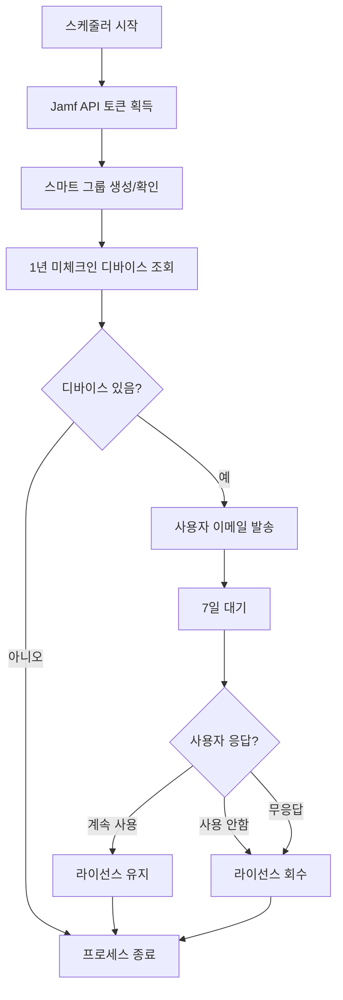

# Jamf Pro License Manager

1년 이상 체크인하지 않은 디바이스의 Jamf Pro 라이선스를 자동으로 회수하는 시스템입니다.

## 주요 기능

1. **스마트 그룹 자동 생성**: 1년 이상 체크인하지 않은 디바이스를 자동으로 식별
2. **사용자 알림 시스템**: 라이선스 회수 전 사용자에게 이메일 확인 요청
3. **웹 기반 확인**: 사용자가 간편하게 디바이스 사용 여부를 확인할 수 있는 웹 인터페이스
4. **자동 라이선스 회수**: 사용자 응답에 따른 자동 라이선스 회수
5. **스케줄러**: 주기적 자동 실행

## 시스템 구성

```
jamf_license_manager.py    # 메인 라이선스 관리 시스템
web_interface.py          # 사용자 확인을 위한 웹 인터페이스
scheduler.py             # 주기적 실행을 위한 스케줄러
config.json             # 시스템 설정 파일
license_manager.db      # SQLite 데이터베이스 (자동 생성)
```

## 설치 방법

### 1. 시스템 요구사항
- Python 3.7 이상
- Jamf Pro API 접근 권한
- SMTP 이메일 서버 접근 권한

### 2. 자동 설치
```bash
chmod +x install.sh
./install.sh
```

### 3. 수동 설치
```bash
# 가상환경 생성
python3 -m venv jamf_license_env
source jamf_license_env/bin/activate

# 패키지 설치
pip install -r requirements.txt

# 실행 권한 부여
chmod +x *.py *.sh
```

## 설정

### 1. config.json 파일 편집

```json
{
  "jamf": {
    "url": "https://your-jamf-server.com",
    "username": "your-api-username",
    "password": "your-api-password"
  },
  "email": {
    "smtp_server": "smtp.gmail.com",
    "smtp_port": 587,
    "username": "your-email@company.com",
    "password": "your-app-password",
    "sender_email": "it-admin@company.com"
  },
  "web_interface": {
    "url": "http://your-server:5000",
    "secret_key": "your-secret-key-here"
  },
  "settings": {
    "notification_grace_period_days": 7,
    "check_interval_hours": 24,
    "smart_group_name": "License Recovery - 1년 미체크인 디바이스"
  }
}
```

### 2. Jamf Pro 설정
- API 사용자 계정 생성
- 필요한 권한:
  - Computer Groups: Create, Read, Update
  - Computers: Read, Update
  - Smart Computer Groups: Create, Read, Update

### 3. 이메일 설정
- SMTP 서버 정보 확인
- Gmail 사용 시 앱 비밀번호 생성 필요

## 사용 방법

### 1. 웹 인터페이스 실행
```bash
./run_web.sh
# 또는
python web_interface.py
```
- 브라우저에서 `http://localhost:5000/status` 접속하여 상태 확인

### 2. 스케줄러 실행 (백그라운드)
```bash
./run_scheduler.sh
# 또는
python scheduler.py
```

### 3. 수동 실행
```bash
source jamf_license_env/bin/activate
python jamf_license_manager.py
```

## 프로세스 흐름



## 웹 인터페이스

### 사용자 확인 페이지
- URL: `/confirm?device_id=123&token=abc123`
- 사용자가 디바이스 사용 여부를 선택
- 보안 토큰으로 접근 제한

### 관리자 상태 페이지
- URL: `/status`
- 시스템 통계 및 현황 확인
- 총 알림 발송, 응답률, 라이선스 회수 현황

## 로그 및 모니터링

### 로그 파일
- `jamf_license_manager.log`: 메인 시스템 로그
- `scheduler.log`: 스케줄러 로그

### 데이터베이스
- `license_manager.db`: SQLite 데이터베이스
- 사용자 확인 상태, 응답 기록 저장

## 보안 고려사항

1. **API 인증**: Jamf Pro API 계정은 최소 권한으로 설정
2. **토큰 보안**: 웹 확인 링크는 일일 토큰으로 보호
3. **데이터 암호화**: 민감한 정보는 별도 보안 조치 필요
4. **HTTPS 사용**: 프로덕션 환경에서는 HTTPS 필수

## 문제 해결

### 일반적인 오류

1. **API 토큰 획득 실패**
   - Jamf Pro 서버 URL 확인
   - 사용자 인증 정보 확인
   - 네트워크 연결 상태 확인

2. **이메일 발송 실패**
   - SMTP 서버 설정 확인
   - 인증 정보 확인 (앱 비밀번호 등)
   - 방화벽 설정 확인

3. **스마트 그룹 생성 실패**
   - API 권한 확인
   - 그룹 이름 중복 확인

### 로그 확인
```bash
# 실시간 로그 모니터링
tail -f jamf_license_manager.log

# 에러 로그만 확인
grep ERROR jamf_license_manager.log
```

## 시스템 관리

### 정기 점검 항목
1. 로그 파일 크기 및 내용 확인
2. 데이터베이스 백업
3. 설정 파일 보안 점검
4. API 토큰 만료 여부 확인

### 백업
```bash
# 데이터베이스 백업
cp license_manager.db license_manager_backup_$(date +%Y%m%d).db

# 설정 파일 백업
cp config.json config_backup_$(date +%Y%m%d).json
```

## 커스터마이징

### 알림 기간 변경
`config.json`에서 `notification_grace_period_days` 값 수정

### 스케줄 변경
`scheduler.py`의 스케줄 설정 부분 수정:
```python
# 매일 오전 9시
schedule.every().day.at("09:00").do(run_license_recovery)

# 매주 월요일
schedule.every().monday.at("09:00").do(run_license_recovery)

# 6시간마다
schedule.every(6).hours.do(run_license_recovery)
```

### 이메일 템플릿 수정
`jamf_license_manager.py`의 `send_user_notification` 메서드에서 이메일 내용 수정

## 지원 및 문의

시스템 관련 문의사항이 있으시면 IT 관리팀에 연락주세요.

## 라이선스

이 프로젝트는 내부 사용을 위한 것입니다.

---

**주의사항**: 이 시스템은 실제 Jamf Pro 라이선스에 영향을 미칠 수 있습니다. 프로덕션 환경에서 사용하기 전에 반드시 테스트 환경에서 충분히 검증하시기 바랍니다.
